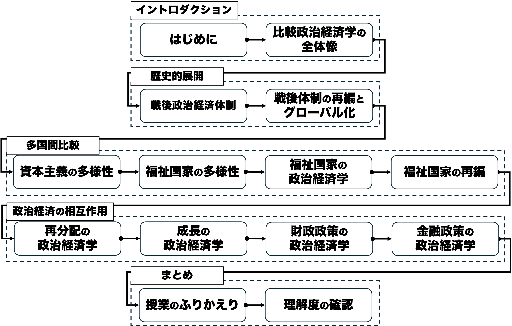
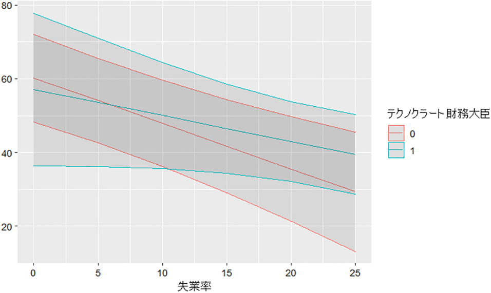

## 今日の目次

1. はじめに
1. 戦後福祉国家の発展段階
1. 拡充期の理論
1. 経路依存論
1. 党派性理論
1. まとめ

# はじめに
## 先週のRP
TBD

## 本日の目的と到達目標
#### 目的
福祉国家の発展と変容をめぐる代表的な理論を学ぶ。まず、戦後の福祉国家が辿ってきた過程を3つの段階に分けて把握する。続いて福祉国家の代表的な理論の2つである権力資源動員論と経路依存論を取り上げ、両者の論争を理解する。続いて福祉国家のみならず比較政治経済学全般でも重要な党派性理論を紹介する。

::: {.fragment .fade-in}
#### 到達目標
1. 戦後福祉国家の発展について、3つの段階に分けながら説明できる。
1. 権力資源動員論の立場から福祉国家の多様性がなぜ生まれたのかを説明できる。
1. 権力資源動員論に対する批判に言及しつつ、福祉国家の経路依存論の議論を説明できる。
1. 党派性理論の立場による福祉国家の発展と変容を説明できる。

:::

## 本日の授業の位置付け

# 福祉国家の発展段階
## 福祉国家の発展段階
::: {.incremental}
- **福祉拡充期**（40-50s）…福祉がどの国でも拡大
  - 埋め込まれた自由主義に基づく福祉国家への合意
  - 福祉国家がフォーディズムを補完し、経済成長へ
- **福祉縮減期**（70-80s）…福祉縮減が試みられる
  - ブレトン・ウッズ体制の崩壊とオイルショック
  - 経済の構造転換によるフォーディズムの終焉
- **福祉再編期**（90s-）…福祉の部分的拡充が目指される
  - グローバル競争を勝ち抜くための投資の必要性
  - **新しい社会的リスク**…雇用の不安定化と家族の多様性
     - **古い福祉**から**新しい福祉**への転換（次週）

:::

## 代表的な福祉国家理論
::: {.incremental}
- **産業主義理論**と**権力資源動員論**→福祉拡充期に焦点
- **経路依存論**→福祉縮減期に焦点
- **アイデア・言説理論**→福祉再編期に焦点
  - 本授業では割愛
- **党派性理論**→拡充・縮減・再編いずれにも焦点

:::

## クイズ（わせポチ）
次の記述のうち、戦後福祉国家の発展段階について正しいものをすべて選んでください。

1. 福祉拡充期には、福祉国家の拡大が広く進み、経済成長との両立が目指された。
1. 福祉縮減期には、経済の構造転換や財政問題を背景として、福祉国家の縮小が試みられた。
1. 福祉再編期には、従来の年金や医療を全面的に廃止し、教育や子育て支援に置き換えることが目指された。
1. 福祉再編期には、グローバル競争や新しい社会的リスクへの対応が課題となった。
1. 福祉縮減期には、福祉国家が実際に大幅に縮小したため、先進国間の福祉制度の違いはほぼ消滅した。

# 拡充期の理論
## 産業主義理論 (industrialist theory)
経済が発展すれば福祉国家は発展

<iframe src="https://ourworldindata.org/grapher/government-spending-vs-gdp-per-capita?tab=chart" loading="lazy" style="width: 100%; height: 600px; border: 0px none;" allow="web-share; clipboard-write"></iframe>

## 権力資源動員論
#### power resource theory
利益集団（労働者や使用者）がどの程度権力資源を有しているのかに着目

::: {.incremental}
- 経済的要因だけでなく政治的要因の重要性を強調するとともに、福祉国家間の違いを説明
- **ウォルター・コルピ**「福祉国家の充実度合いは**労働者階級の強さ**で決まる」[^korpi1983]
    - 北欧は労働者階級が強い→福祉が制度化
    - 米国は労働者階級が弱い→福祉が貧弱

:::

[^korpi1983]: Korpi, Walter, 1983, *The Democratic Class Struggle,* Routledge.

## 『3つの世界』と権力資源動員論
エスピン＝アンデルセンも3つの類型の違いを権力資源動員論で説明

::: {.incremental}
- **社民主義モデル**…手厚く普遍主義的な福祉
    - **労働組合**と**社民主義政党**の主導
- **自由主義モデル**…貧弱で選別主義的な福祉
    - **資本家階級**と**自由主義**の主導
- 保守主義モデル…手厚いが階層性の高い福祉
    - **保守勢力**や**カトリック教会**の主導
    - **階層性の原理**…個人や家族で対処しきれない部分を中間団体が救済

:::

::: {.fragment .fade-in}
Q. カトリック教会はなぜ手厚い福祉を支持した？（わせポチ）
:::

## キリスト教民主主義
::: {.columns}
::: {.column width=70%}
**教皇レオ13世**回勅「Rerum Novarum」

::: {.fragment .fade-in}
::: {style="font-size: 75%;"}

> …現在激化している対立の要因は、産業活動の広範な拡大や科学の驚異的な発見、雇用主と労働者の関係の変化、ごく少数の個人による莫大な富と大衆の極度の貧困、労働者階級の自立心の増大と相互連帯の強化…

> …狡猾な扇動者たちが、こうした意見の相違を利用して人々の判断を歪め、民衆を反乱へと駆り立てようと企んでいる…

> いずれにせよ、労働者階級の大半を不当に苦しめている悲惨な状況に対して、早急に適切な救済策を見出さなければならない…

:::
:::

:::

::: {.column width=30%}

:::

:::

# 経路依存論
## 質問（わせポチ）
政府が財政赤字を減らすために年金給付の削減を提案したとします。

この政策を実現するうえで、政府はどのような政治的困難に直面するでしょうか。

## 経路依存論
#### path dependency theory
ある制度が成立すると現状維持に向かうメカニズムに着目

::: {.incremental}
- 1980年代以降、新自由主義の動きの一環で福祉縮減が目指される
   - 例：サッチャリズム、レーガノミクス
- しかし実際には福祉の規模は維持→**経路依存**

:::

---

<iframe src="https://ourworldindata.org/grapher/social-spending-oecd-longrun?time=1960..2024&country=CAN~JPN~USA~ITA~DEU~FRA~GBR&tab=line" loading="lazy" style="width: 100%; height: 600px; border: 0px none;" allow="web-share; clipboard-write"></iframe>

## ピアソンの経路依存論[^pierson1996]
::: {.columns}
::: {.column width=70%}
福祉縮減期には拡充期とは異なる「**新しい政治**」が繰り広げられる

::: {.incremental}
- 権力資源動員論は福祉拡充期にしか当てはまらない
   - 資本家と労働者の階級闘争
- 福祉国家が出来上がった現在、**福祉受給者**という新たなアクターが出現
- 政治家は受給者からの非難を受けたくない
- 縮減するならば**非難回避**をどうするかが問題

:::
:::

::: {.column width=30%}
{.r-stretch}
:::
:::

[^pierson1996]: Pierson, P. (1996). The new politics of the welfare state. *World Politics, 48*(2), 143-179.

## 非難回避戦略としてのテクノクラート[^iseki2023]
{width=80%}

[^iseki2023]: 井関竜也（2023）「テクノクラート財務大臣と経済投票：専門家による政策決定はアカウンタビリティを阻害するか」『比較政治研究』9, pp.1-29．

# 党派性理論
## 質問（わせポチ）
あなたが会社員で、特に資産はないとします。次のうち、どちらの経済状況を望みますか？

1. 物価は安定しているが、失業率は高い。
1. 失業率は低いが、物価が上がり続けている。

::: {.fragment .fade-in}
あなたが多額の預貯金や金融資産を持っているとします。次のうち、どちらの経済状況を望みますか？

1. 物価は安定しているが、失業率は高い。
1. 失業率は低いが、物価が上がり続けている。

:::

## 党派性理論 (partisan theory)
左派や右派といった党派性に着目

::: {.incremental}
- **ダグラス・ヒッブス**「政権の党派性によりマクロ経済実績が異なる」[^hibbs1977]
   - 右派：使用者や資産家の支持→緊縮的な財政政策→低インフレ・高失業
   - 左派：労働者や低所得者の支持→拡張的な財政政策→高インフレ・低失業

:::

[^hibbs1977]: Hibbs, D. A. (1992). Partisan theory after fifteen years. *European Journal of Political Economy, 8*(3), 361-373.

## 縮減と党派性

**コルピ**と**パルメ**「縮減期でも党派性の影響はある」[^korpi2003]

::: {.incremental}
- 社民政権下で縮減は小さい
-  保守政権下で縮減は大きい

:::

[^korpi2003]: Korpi, W., & Palme, J. (2003). New Politics and Class Politics in the Context of Austerity and Globalization: Welfare State Regress in 18 Countries, 1975–95. *American Political Science Review, 97*(03).

## 再編と党派性
**ホイザーマン**「新しい福祉でも党派性は重要」[^haeusermann2012]

::: {.incremental}
- 保守政党→新しい福祉も古い福祉も削減
- 自由主義政党→古い福祉は削減しつつ新しい福祉には多少積極的
- 左派政党→古い福祉も新しい福祉も積極的
   - ただし旧左派（社民）と新左派（緑）で重点に差

:::

[^haeusermann2012]: Häusermann, Silja, 2012, "The Politics of Old and New Social Policies," in Giuliano Bonoli and David Natali eds., *The Politics of the New Welfare State,* Oxford University Press: 111-132. 

# まとめ
## 本日の目的と到達目標
#### 目的
福祉国家の発展と変容をめぐる代表的な理論を学ぶ。まず、戦後の福祉国家が辿ってきた過程を3つの段階に分けて把握する。続いて福祉国家の代表的な理論の2つである権力資源動員論と経路依存論を取り上げ、両者の論争を理解する。続いて福祉国家のみならず比較政治経済学全般でも重要な党派性理論を紹介する。

::: {.fragment .fade-in}
#### 到達目標
1. 戦後福祉国家の発展について、3つの段階に分けながら説明できる。
1. 権力資源動員論の立場から福祉国家の多様性がなぜ生まれたのかを説明できる。
1. 権力資源動員論に対する批判に言及しつつ、福祉国家の経路依存論の議論を説明できる。
1. 党派性理論の立場による福祉国家の発展と変容を説明できる。

:::

## 次回までに
#### 事前学習
- 教科書（第6章）を読む。

#### 事後学習

 - 授業資料を見直し、目標到達をセルフチェック
 - Moodle上でのリアクションペーパー入力（木曜日まで）