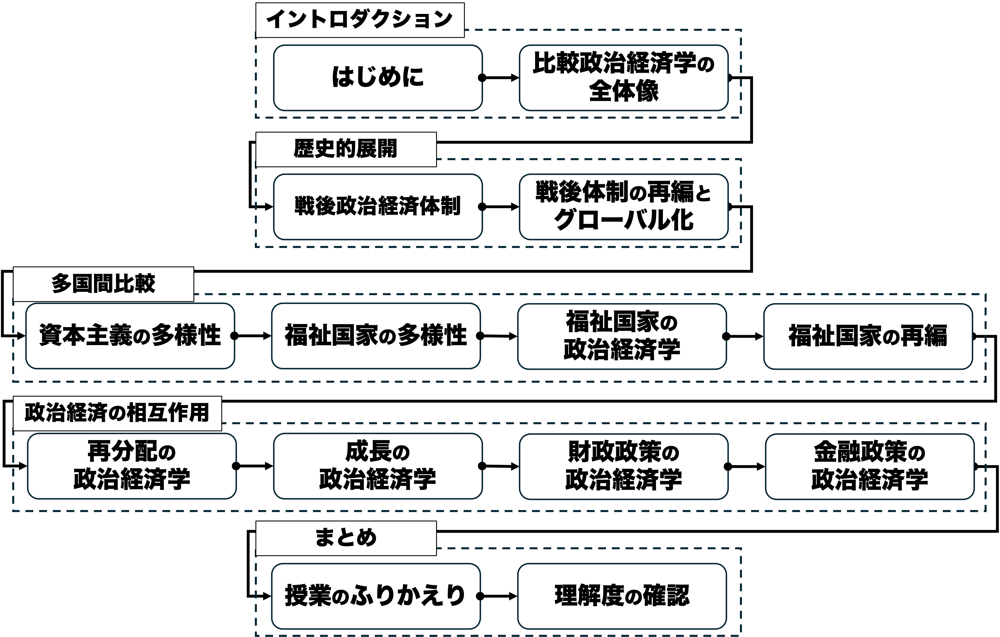

## 今日の目次

1. はじめに
1. ポスト工業化と新しいリスク
1. 社会的投資
1. 福祉多元主義
1. 移民と福祉国家
1. まとめ

# はじめに
## 先週のRP
TBD

## 本日の目的と到達目標 {.smaller}
#### 目的
福祉国家が近年直面している変容圧力と再編戦略を学ぶ。ポスト工業化がもたらした新しい社会的リスクと、その対応策としての「社会的投資」戦略を概観する。また福祉供給主体が多元化する現象である福祉多元主義を学び、国以外にどのような福祉供給主体が現れたかを知る。また、近年増大する移民が福祉国家に与える影響を考察する。

::: {.fragment .fade-in}
#### 到達目標
1. ポスト工業化および「新しい社会的リスク」が福祉国家にどのような圧力を与えるのか説明できる。
1. 社会的投資とはどのような政策であるのか、従来の福祉との違いに注目しながら説明できる。
1. 福祉多元主義における国家以外の福祉供給主体を2つ挙げ、それぞれの特徴を説明できる。
1. 移民が福祉国家に与える影響について、「進歩主義のジレンマ」と「福祉排外主義」という概念を用いて説明できる。
:::

## 本日の授業の位置付け

# ポスト工業化と新しいリスク
## 福祉国家変容の圧力
#### グローバル化 (globalization)
国境を超えた社会的経済的な結びつき

::: {.incremental}
- **収斂仮説**…底辺への競争や福祉の削減
- **補償仮説**…ショックに備える福祉へのニーズ増大

:::

::: {.fragment .fade-in}
#### ポスト工業化 (postindustrialization)
製造業からサービス産業への移行

:::

## ポスト工業化の影響

**フォーディズム**の危機→福祉国家解体の圧力

::: {.incremental}
- サービス産業は生産性向上が難しく、賃金上昇が抑制
- 財源が減少し従来型福祉国家の維持が困難に
:::

::: {.fragment .fade-in}
**新しい社会的リスク**→新しい福祉のニーズ

::: {.incremental}
- **雇用の不安定化**…短時間・短期雇用の増大→賃金の減少→男性稼得者モデルの維持が困難
- **家族ケア**の減少…男性稼得者モデルの崩壊→女性の社会進出→家事・育児の供給減

:::
:::

## 質問（わせポチ）
これらの新しい社会的リスクに対応する政策として、具体的にはどのような政策があり得るでしょうか。

# 社会的投資
## 社会的投資（social investment）
新しい社会的リスクに対処する福祉政策

::: {.fragment .fade-in}
](figs/social_investment.png){width=80%}
:::

## 従来型福祉との違い
従来型の福祉（年金・失業手当など）は**事後的**

::: {.incremental}
- 失業・高齢・疾病などのリスクが発生した**後**の対応

:::

::: {.fragment .fade-in}
社会的投資は**事前的**

::: {.incremental}
- 貧困や孤立、失業が生じないよう能力獲得を支援
- 見返りを求める側面
   - **経済的見返り**…経済成長と税収増
   - **社会的見返り**…社会の連帯の再構築

:::
:::

## 導入の背景
2000年の**EUリスボン戦略**で提唱

::: {.incremental}
- Cf. 福祉多元主義

:::

::: {.fragment .fade-in}
従来とは異なる**新たな政策パラダイム**として登場

::: {.incremental}
- **ケインズ主義福祉国家**と**新自由主義**を乗り越える
-  「第3の道」→欧州社民政党の改革路線
- 従来の福祉を置き換えるのではなく保管するものとして提唱

:::
:::

## アンケート（わせポチ） 
1. あなたは社会的投資政策を積極的に進めることに賛成ですか？
1. あなたは年金などの従来型福祉を削ってでも社会的投資政策を進めていくことに賛成ですか？

## 導入の状況
EUレベルで提唱されたこともあり、欧州が進む

::: {.incremental}
- 最も積極的な北欧と遅れている南欧・東欧

:::

::: {.fragment .fade-in}
日本では概念自体が浸透していないが、基本的には人気[^brazzill2020]

::: {.incremental}
- 女性や社会文化的リバタリアン、高所得者が特に支持
- 従来型の所得保障を削るのとセットでは不人気

:::

:::

[^brazzill2020]: Brazzill, M., Magara, H., & Yanai, Y. (2020). When voters favour the social investment welfare state. *Japanese Journal of Political Science, 21*(4), 194–205. doi:10.1017/S1468109920000122 

# 福祉多元主義
## 質問（わせポチ）
福祉の提供は主に国家が行っていますが、営利企業や非営利法人、国際機関もまた福祉の提供に関わります。国家・営利企業・非営利法人・国際機関は、それぞれどのような形で福祉の供給に関わり、どのようなメリット・デメリットを持つでしょうか。（どれか一部で良い）

## 福祉多元主義
福祉の供給主体が国家以外にも広がっていく現象

::: {.incremental}
- 民間組織…社会的排除に対する機動的な対応が可能
- 国際機関…グローバルな次元での福祉政策を方向付け&国家の福祉供給を補完

:::

## 民間による福祉
#### サードセクター（third sector）
営利組織でも公的組織でもない主体

::: {.incremental}
- 例：協同組合、共済団体、NPO

:::

::: {.fragment .fade-in}
#### 社会的企業（social enterprise）
社会的事業を行うことで利潤を獲得し、メンバーやコミュニティに還元する企業

::: {.incremental}
- 例：[ワイズグループ](https://www.thewisegroup.co.uk/)…失業者を雇用して公営住宅修繕と地域環境保全
- 例：[リタリコ](https://litalico.co.jp/)…障害者向けの就労支援

:::
:::

## 国際組織による福祉
特に欧州連合（EU）はさまざま側面で福祉供給に影響

::: {.incremental}
- **社会的規制**…EUレベルの法的基準や規範の整備
- **ハードな調整**…各国の政策実施の監督・促進
- **ソフトな調整**…欧州レベルの政策目標と評価基準作成

:::

# 移民と福祉国家
## 質問（わせポチ）
あなたが納めた税金を使って、生活に困っている人を支援するとします。次のうち、どの制度を支持しますか。

1. 日本国籍を持つ人だけを対象とする
1. 日本国籍を持つ人を優先するが、一定の条件で外国人も対象とする
1. 国籍にかかわらず、困っている人を対象とする

## 移民と福祉国家
相互信頼を前提とする福祉国家は、移民と両立可能か？

::: {.incremental}
- 進歩主義のジレンマ
- 福祉排外主義

:::

## 進歩主義のジレンマ
寛大な移民政策と寛大な福祉国家は両立しない

::: {.incremental}
- 相互信頼→寛大な福祉国家
- 移民による人種的多様性は相互信頼を損なう
- 実証的論争：
   - 人種的多様性が高いアメリカで福祉が発展していない
   - 北欧は寛大な移民政策と寛大な福祉国家を両立

:::

## 福祉排外主義（welfare chauvinism）
福祉国家の規模を維持しつつ、移民を排除しようとする動き

::: {.incremental}
- 例：デンマーク国民党、参政党、日本保守党
- 移民はそもそも貧しい→福祉の財源を使われるという危機感
- 他方、移民は福祉の対象になりにくいのが実態
- 再分配のあり方との関係
  - **選別主義**…給付を貧困層だけに絞る→拠出者と受給者の分断→福祉排外主義が広まりやすい
  - **普遍主義**…給付を社会全体に行う→拠出者と受給者の分断が曖昧→福祉排外主義が広まりにくい

:::

# まとめ
## 本日の目的と到達目標 {.smaller}
#### 目的
福祉国家が近年直面している変容圧力と再編戦略を学ぶ。ポスト工業化がもたらした新しい社会的リスクと、その対応策としての「社会的投資」戦略を概観する。また福祉供給主体が多元化する現象である福祉多元主義を学び、国以外にどのような福祉供給主体が現れたかを知る。また、近年増大する移民が福祉国家に与える影響を考察する。

::: {.fragment .fade-in}
#### 到達目標
1. ポスト工業化および「新しい社会的リスク」が福祉国家にどのような圧力を与えるのか説明できる。
1. 社会的投資とはどのような政策であるのか、従来の福祉との違いに注目しながら説明できる。
1. 福祉多元主義における国家以外の福祉供給主体を2つ挙げ、それぞれの特徴を説明できる。
1. 移民が福祉国家に与える影響について、「進歩主義のジレンマ」と「福祉排外主義」という概念を用いて説明できる。
:::

## 次回までに
#### 事前学習
- 教科書（第8章）を読む。

#### 事後学習

 - 授業資料を見直し、目標到達をセルフチェック
 - Moodle上でのリアクションペーパー入力（木曜日まで）